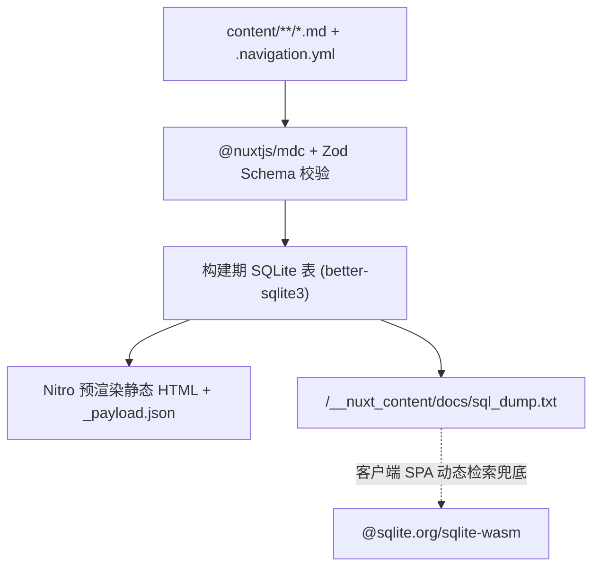

# 04. 目录结构与路由取舍（Nuxt Content v3 实测）

静态网站生成器的目录组织受制于**本地编辑器可读顺序**、**线上 URL 纯净度**与**多级侧边栏自动化**这组经典权衡。`@nuxt/content` (`3.17.0`) 给出了一套极具辨识度的 **“单层 `content/` 隔离 + `1.` 点号前缀剥离 + `.navigation.yml` + SQLite 集合查询”** 组合拳，但与纯正 GFM 母版对照时仍有明确的取舍边界。

## 1. 内容目录隔离：`content/` 单层收束 vs 全栈框架底座

- **单层隔离恰到好处**：所有 Markdown 文档统一放在仓库根目录下的 `content/`（仅 1 层深度，比 Astro Starlight 强制 3 层深的 `src/content/docs/` 轻量得多），且模块自动注入 `ignore: ['content/**']`，根目录 `README.md` 绝不会被误编译成网页。
- **工程复杂度代价**：不同于开箱自带整套默认主题的 VitePress / Starlight，裸 `@nuxt/content` 只提供 `<ContentRenderer>` 与数据查询 API，开发者需自行编写 `pages/[...slug].vue`、侧边栏布局组件或额引入重型 Nuxt UI Pro 文档模板。

## 2. 关键实测发现：`1.` 点号前缀自动剥离 vs `01-` 连字符原样保留

深入检查 `@nuxt/content/dist/module.mjs` 内置的 `refineUrlPart` 源码可见其核心正则：

```js
function refineUrlPart(name) {
  return name
    .replace(/(\d+\.)?(.*)/, '$2')
    .replace(/^index(\.draft)?$/, '')
    .replace(/\.draft$/, '')
}
```

| 命名约定 | 本地文件树排序 | Nuxt Content 生成路由 | 派生迁移代价实测 |
| :--- | :--- | :--- | :--- |
| **点号前缀 `1.order.md`**（Nuxt 官方推荐） | IDE 按 `1.`、`2.` 顺序整齐排列 | 自动剥离 `1.` 生成干净路由 `/order` | 原生化解本地乱序与 URL 污染！但需将母版 `01-` 批量改名为 `1.`，且破坏离线 `.md` 相对链接 |
| **连字符前缀 `01-order-and-url.md`**（本基准保留母版文件名） | 按 `01-`、`02-` 整齐排列 | **不匹配 `(\d+\.)` 正则**，原样保留为 `/01-order-and-url` | 配合 `content.config.ts` 的 `order` 列可精准控制导航排序，但序号仍保留在 URL 中 |

::callout{type="warning" title="源码级实测陷阱：相对路径 .md 链接归一化"}
`@nuxt/content` 的 `normaliseLink` 在转换相对 `.md` 链接（如 `./nested/01-order-and-url.md` 或 `../index.md`）时，会对每个路径段执行 `slugify`，导致 `.` 与 `..` 被转为空字符串而丢失当前父目录上下文！因此在 Nuxt Content 文档内部互链时，应改写为以 `/` 开头的集合根路径（由 `<NuxtLink>` 自动拼接 `app.baseURL`）。
::

## 3. 多级侧边栏：`.navigation.yml` + `queryCollectionNavigation`

在 `04-directory/nested/` 子目录测试中，Astro Starlight 的 `autogenerate` 会直接把英文文件夹名 `nested` 暴露为侧边栏分组标题；而 Nuxt Content 只需在子目录放入 1 行 `content/04-directory/nested/.navigation.yml`（`title: "嵌套子页实测 (.navigation.yml)"`），`queryCollectionNavigation('docs')` 便会在构建期从 SQLite 合并出中文多级菜单：

- [进入子文档 A：排序前缀与 URL 纯净度权衡](/04-directory/nested/01-order-and-url)
- [进入子文档 B：多级子目录与侧边栏同步机制](/04-directory/nested/02-sidebar-sync)


